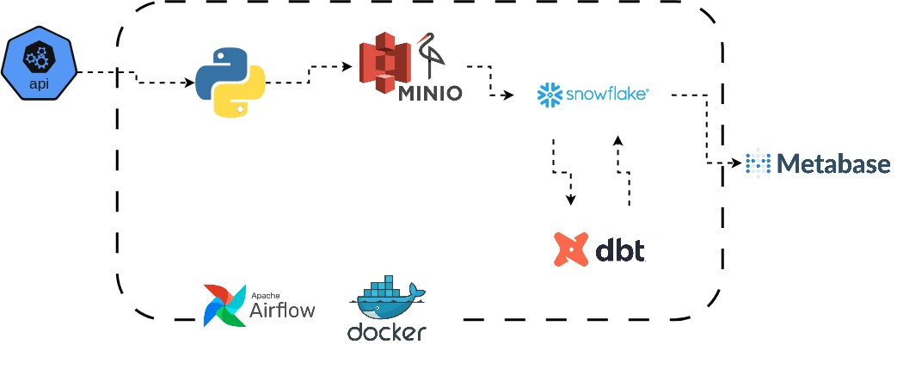
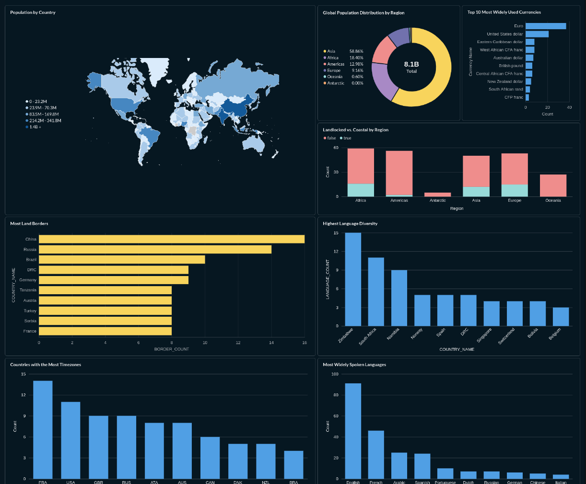

# Triplens Global Countries Explorer

## Architecture



1. **Extract:** Python extracts ~250 country records from the REST Countries API with pagination handling and rate-limit throttling.
2. **Land:** Raw dated JSON snapshots land in **MinIO** (S3-compatible object storage) as an immutable audit layer.
3. **Load:** Python stages and bulk-loads the raw JSON into **Snowflake** (`RAW.COUNTRIES_RAW`) using the `VARIANT` data type and `STRIP_OUTER_ARRAY`.
4. **Transform: dbt Core** cleans, types, and unnests semi-structured arrays into star-schema dimensional tables (`ANALYTICS` schema).
5. **Orchestrate:** **Apache Airflow** (via Astronomer) automates daily scheduled runs with dependency management and retries.
6. **Visualize:** **Metabase** connects natively to Snowflake to power interactive filtering and travel analytics.

## Tech Stack

| Layer | Tool | Purpose |
|---|---|---|
| **Data Source** | REST Countries API v5 | Global country attributes, borders, and demographics |
| **Extraction** | Python 3.12 (`requests`) | Paginated API ingestion with rate limiting |
| **Landing Zone** | MinIO | S3-compatible local object storage |
| **Data Warehouse** | Snowflake | Cloud data warehousing with native `VARIANT` support |
| **Transformation** | dbt Core (`dbt-snowflake`) | Staging views, dimensional marts, and schema testing |
| **Orchestration** | Apache Airflow (Astronomer) | Automated pipeline scheduling and DAG retries |
| **BI & Analytics** | Metabase | Interactive dashboards and KPI exploration |
| **CI/CD & Containers** | Docker, GitHub Actions | Containerized services, Ruff linting, and dbt compile checks |

## Data Modeling & Marts
- **`dim_countries`**: Core entity dimension containing 250 ISO-standard countries with population, landlocked status, and region.
- **`dim_languages`**: Country-to-language mappings unnested via `LATERAL FLATTEN`.
- **`dim_currencies`**: Country-to-currency mappings with currency codes and symbols.
- **`dim_timezones`**: Country-to-timezone mappings.
- **`bridge_borders`**: Many-to-many bridge table resolving shared international borders.

## Metabase Dashboard Snippet


## Local Setup

### Prerequisites
- Docker & Docker Compose
- Astro CLI (`curl -sSL install.astronomer.io | sudo bash -s`)
- Snowflake account
- Python 3.12+ (or `uv`)

### 1. Environment Setup
Clone the repository and configure your `.env` file:
```bash
cp .env.example .env
# Fill in your Snowflake and API credentials in .env
```

### 2. Start Object Storage & BI
```bash
docker compose -f docker-compose.yml up -d
```
- MinIO Web Console: `http://localhost:9001` (login: credentials in `.env`)
- Metabase: `http://localhost:3000`

### 3. Start Airflow Orchestrator
```bash
astro dev start
```
- Airflow UI: `http://localhost:8080` (admin / admin)
- Trigger `triplens_countries_pipeline` to run the full extraction, loading, and dbt models.

### 4. Running dbt Tests Locally
```bash
uv run --env-file .env dbt test --project-dir dbt --profiles-dir dbt
```